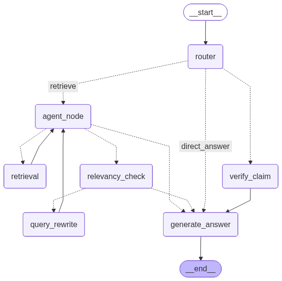

<div align="center">

# 📚 PaperLens

An agentic RAG research assistant. Chat with your research papers, pull in arXiv and web sources, and check whether a paper's claims still hold up against newer research.


</div>

> [!NOTE]
> **Note from the Owner:** Every chat session gets its own knowledge base. Papers you load in one chat are not visible in any other chat.

---

## ✨ What can it do?

- **Ask questions about your papers**: upload PDF, TXT or Markdown files, load web pages, or pull papers straight from arXiv by ID or title.
- **Verify a claim**: paste a claim from a paper and PaperLens searches the web and arXiv for newer work that challenges or supersedes it, with links.
- **Search the web**: questions about current events or recent developments are answered with live Tavily results.
- **`/btw` side questions**: start a message with `/btw` to ask something off-topic without adding it to the session history.
- **Persistent sessions**: chats are saved with SQLite checkpoints and auto-named from your first message.
- **Inspect the agent**: every answer has a 📊 *Graph state* panel showing the route taken, the retrieved chunks and the retry counts.

---

## 🧠 How it works

<div align="center">

</div>

| Node | What it does |
| :--- | :--- |
| `router` | Classifies the question as `retrieve`, `verify_claim` or `direct_answer`. |
| `agent_node` | Picks a tool (your papers or web search) and writes the search query. Capped at 3 tool calls per question. |
| `retrieval` | Runs the tool: a Qdrant similarity search over your papers, or a Tavily web search. |
| `relevancy_check` | Checks whether the retrieved chunks actually answer the question. |
| `query_rewrite` | If they don't, rewrites the query once and sends it back to the agent. |
| `verify_claim` | Searches the web and arXiv for newer work and returns a verdict with up to 3 superseding papers. |
| `generate_answer` | Writes the final answer and streams it to the UI. |

```text
PaperLens/
├── app.py                     # Streamlit UI (sessions, document loaders, chat)
├── backend/
│   ├── rag_graph.py           # LangGraph workflow (router, agent, tools, claim verification)
│   ├── vector_store.py        # Qdrant collections + cached OpenAI embeddings
│   ├── paper_loader.py        # PDF / TXT / Markdown / web page / arXiv loaders and chunking
│   ├── btw_handler.py         # /btw side-channel answers
│   └── models.py              # Pydantic schemas for structured LLM outputs
├── evaluate.py                # DeepEval evaluation of the RAG pipeline
├── goldens.json               # Question/answer pairs used by the evaluation
├── eval_results.json          # Latest evaluation results
├── documents/                 # Sample report used by evaluate.py
├── graph.png                  # Workflow diagram (above)
├── pyproject.toml / uv.lock   # Dependencies (uv)
├── requirements.txt           # Dependencies (pip / Docker)
├── Dockerfile
├── DOCKER_GUIDE.md            # Docker Hub + EC2 deployment guide
├── docker_install_on_AWS.txt  # Installing Docker on an Ubuntu EC2 instance
└── qdrant_login_steps.md      # Getting Qdrant Cloud credentials
```

---

<details>
<summary><h3>Step 0 — Prerequisites</h3></summary>

<blockquote>

<details>
<summary><strong>Accounts &amp; Keys</strong></summary>

- **OpenAI API Key** from [platform.openai.com](https://platform.openai.com) *(PaperLens uses `gpt-5.4-mini`, `gpt-5-mini` and `text-embedding-3-small`)*
- **Tavily API Key** from [tavily.com](https://tavily.com) *(the free tier is enough)*
- *(Optional)* **Qdrant Cloud** cluster, only if you don't want to run Qdrant locally *(see [qdrant_login_steps.md](qdrant_login_steps.md))*

</details>

<details>
<summary><strong>Local Tools</strong></summary>

- **Python 3.12+** &amp; **`uv`**: dependency management and running the app
- **Docker Desktop**: runs Qdrant locally
- **Git**: cloning the repo

</details>

</blockquote>

</details>

---

<details>
<summary><h3>Step 1 — Local Setup</h3></summary>

<blockquote>

<details>
<summary><strong>1.1 Clone the repo</strong></summary>

```bash
git clone https://github.com/yashsdoshi/PaperLens.git
cd PaperLens
```

</details>

<details>
<summary><strong>1.2 Install dependencies</strong></summary>

```bash
uv sync
```

This creates a `.venv` folder and installs everything from `uv.lock`.

</details>

<details>
<summary><strong>1.3 Start Qdrant</strong></summary>

**Option A: Local (Docker).** Make sure Docker Desktop is running, then:

```bash
docker run -d --name paperlens-qdrant -p 6333:6333 -v paperlens_qdrant:/qdrant/storage qdrant/qdrant
```

> [!TIP]
> Your papers are stored in the `paperlens_qdrant` volume, so they survive restarts. Next time, just run `docker start paperlens-qdrant`.

**Option B: Qdrant Cloud.** Follow [qdrant_login_steps.md](qdrant_login_steps.md) to get your cluster URL and API key.

</details>

<details>
<summary><strong>1.4 Create the <code>.env</code> file</strong></summary>

Create an empty `.env` file in the project root:

**Windows (CMD):**
```cmd
type nul > .env
```

**macOS / Linux:**
```bash
touch .env
```

Then add your keys:

```env
OPENAI_API_KEY=sk-proj-...
TAVILY_API_KEY=tvly-...
QDRANT_URL=http://localhost:6333
QDRANT_API_KEY=
```

> [!IMPORTANT]
> Keep the `QDRANT_API_KEY=` line even when it's empty (local Qdrant). The app reads it at startup and fails if the line is missing. For Qdrant Cloud, use your cluster's URL and API key instead.

</details>

<details>
<summary><strong>1.5 Run the app</strong></summary>

```bash
uv run streamlit run app.py
```

Open [http://localhost:8501](http://localhost:8501) in your browser.

</details>

</blockquote>

</details>

---

<details>
<summary><h3>Step 2 — Using PaperLens</h3></summary>

<blockquote>

<details>
<summary><strong>2.1 Load your documents</strong></summary>

Use the sidebar to add documents to the current chat:

| Source | How |
| :--- | :--- |
| **Files** | Upload PDF, TXT or Markdown files, then click **Add Files**. |
| **Web Pages** | Paste URLs (one per line), then click **Load URLs**. |
| **ArXiv Papers** | Enter an arXiv ID (`1706.03762`) or a title (`Attention Is All You Need`), then click **Load ArXiv Paper**. |

Documents are split into 1,000-character chunks (200 overlap) and embedded with `text-embedding-3-small`. Embeddings are cached in `embedding_cache/`, so loading the same paper again doesn't re-embed it.

</details>

<details>
<summary><strong>2.2 Ask questions</strong></summary>

The router picks the right path for you. Some examples:

| You type | Route |
| :--- | :--- |
| `What dataset did the authors use for training?` | **retrieve**: searches your papers |
| `What are the latest developments in retrieval-augmented generation?` | **retrieve**: searches the web |
| `Is this claim still accurate: "LSTMs outperform transformers on machine translation"` | **verify_claim**: finds newer papers |
| `What is softmax?` | **direct_answer**: no retrieval needed |
| `/btw What is attention?` | **side channel**: not saved to the session |

</details>

</blockquote>

</details>

---

<details>
<summary><h3>Step 3 — Evaluating the RAG Pipeline</h3></summary>

<blockquote>

<details>
<summary><strong>3.1 Run the evaluation</strong></summary>

`evaluate.py` uses [DeepEval](https://github.com/confident-ai/deepeval) to test the pipeline against the sample report in `documents/`. Each question in `goldens.json` runs through the full graph in a fresh session, and the answers are scored on 5 metrics (threshold `0.7`, judged by `gpt-5.4-mini`). If `goldens.json` is missing, new question/answer pairs are generated from the report first.

```bash
uv run evaluate.py
```

Results are saved to `eval_results.json`.

> [!WARNING]
> The evaluation makes a lot of OpenAI calls, so it costs money. Each test case also creates its own Qdrant collection.

</details>

<details>
<summary><strong>3.2 Latest results</strong></summary>

10 test cases from `goldens.json`:

| Metric | Avg score | Passed |
| :--- | :---: | :---: |
| Contextual Precision | 0.98 | 10/10 |
| Contextual Recall | 1.00 | 10/10 |
| Contextual Relevancy | 0.58 | 5/10 |
| Answer Relevancy | 0.99 | 10/10 |
| Faithfulness | 0.98 | 10/10 |

</details>

</blockquote>

</details>

---

<details>
<summary><h3>Step 4 — Running with Docker</h3></summary>

<blockquote>

<details>
<summary><strong>4.1 Build and run the image</strong></summary>

```bash
docker build -t paperlens .
docker run -d -p 8501:8501 --env-file .env --name paperlens paperlens
```

> [!IMPORTANT]
> Inside the container, `localhost` points to the container itself. If Qdrant is running locally in Docker Desktop, set `QDRANT_URL=http://host.docker.internal:6333` in your `.env`.

</details>

<details>
<summary><strong>4.2 Deploy to AWS EC2</strong></summary>

- [ ] Install Docker on your EC2 instance using [docker_install_on_AWS.txt](docker_install_on_AWS.txt).
- [ ] Push the image to Docker Hub and run it on EC2 using [DOCKER_GUIDE.md](DOCKER_GUIDE.md).
- [ ] Open port **8501** in your EC2 security group.

</details>

</blockquote>

</details>

---

<details>
<summary><h3>Troubleshooting</h3></summary>

| Error | Cause | Fix |
| :--- | :--- | :--- |
| `openai.OpenAIError: Missing credentials` or `KeyError: 'QDRANT_URL'` | `.env` is missing, or the app was started from another folder | Create `.env` in the project root (Step 1.4) and run the app from there |
| `Could not load document list — try refreshing.` | Qdrant isn't running | `docker start paperlens-qdrant` |
| `open //./pipe/dockerDesktopLinuxEngine: The system cannot find the file specified` | Docker Desktop isn't running | Start Docker Desktop, wait until it's ready, then retry |
| `model_not_found` from OpenAI | Your key doesn't have access to `gpt-5.4-mini` or `gpt-5-mini` | Change the model names in `backend/rag_graph.py`, `backend/btw_handler.py` and `app.py` |

</details>

---

# <div align="center">Don't forget to leave a star ⭐️</div>
